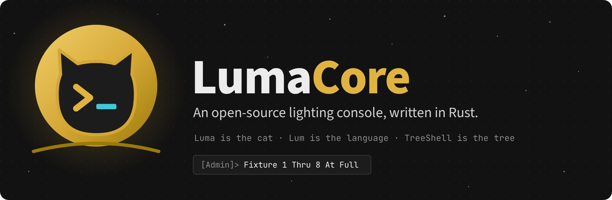
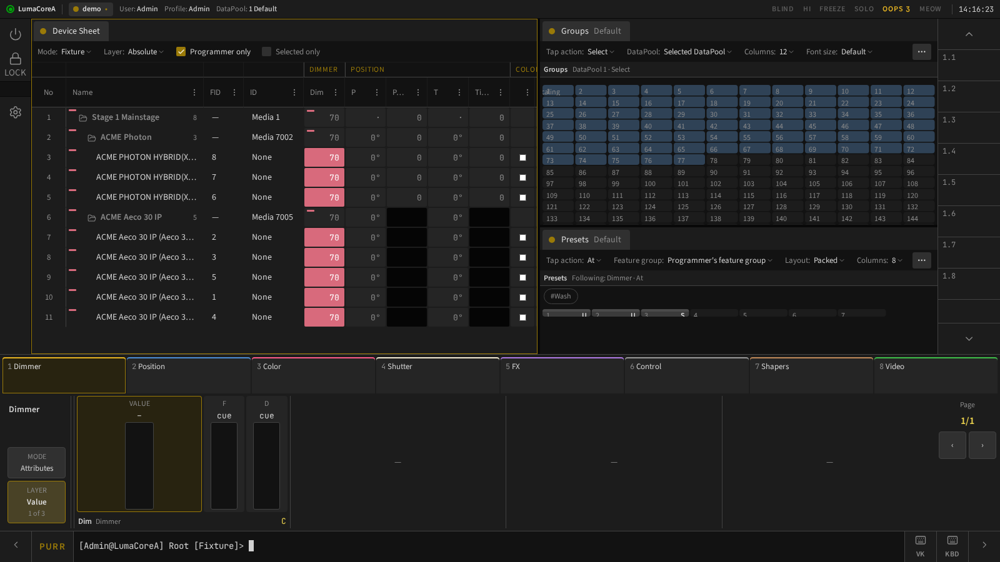
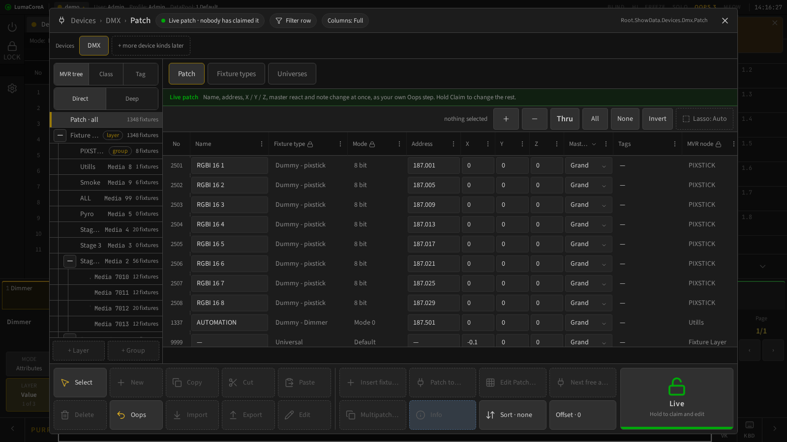
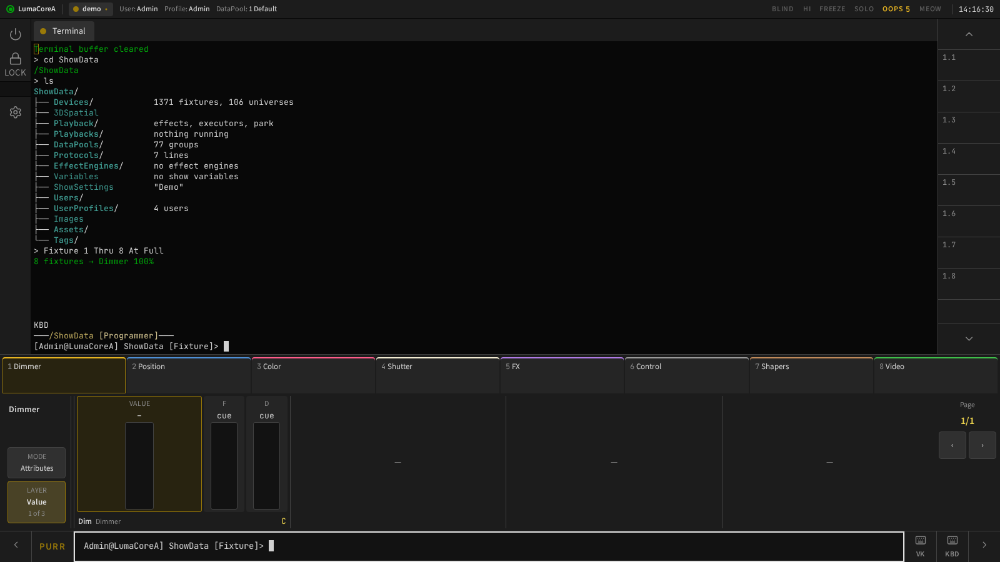
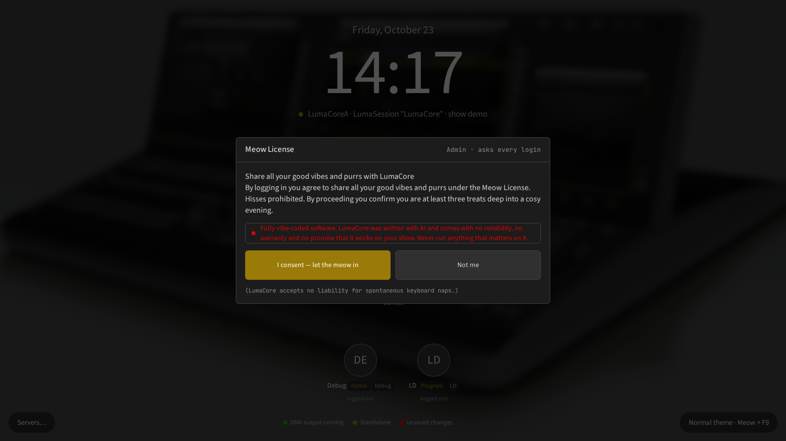
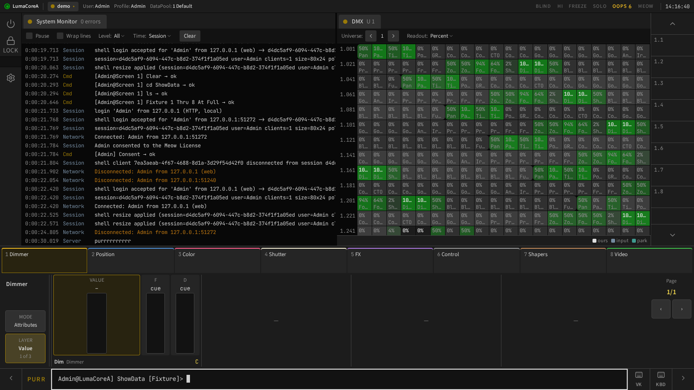
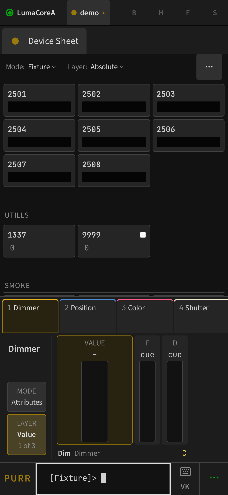

<p align="center">
  
</p>

<p align="center">
  <b>Luma</b> is the cat · <b>Lum</b> is the language · <b>TreeShell</b> is the tree
</p>

# LumaCore

An open-source lighting console, written in Rust. One server, the **station**, owns the show
and sends live DMX (sACN, Art-Net). You drive it from a terminal, a browser, a phone or the
desktop app, all at the same time, and several stations can join into one **LumaSession**.

> [!WARNING]
> **LumaCore is fully vibe-coded software.** It was written with AI, and it comes with no
> reliability, no warranty and no promise that it works on your show. Never run anything that
> matters on it: no paid gigs, no live broadcasts, no audiences you can't apologise to.
> Play with it, learn from it, build on it.

Every login asks you to accept the **Meow License** first. Share all your good vibes and purrs. 🐾

## Contents

- [How it fits together](#how-it-fits-together)
- [Screenshots](#screenshots)
- [How it differs from other consoles](#how-it-differs-from-other-consoles)
- [Quick start](#quick-start)
- [What works today](#what-works-today)
- [Build it with us](#build-it-with-us)
- [Docs](#docs)
- [License](#license)

## How it fits together

LumaCore has one rule: **the station owns the show, and everything else is a view onto it.**

- A **station** is one running `lumacore-server`, the program, on some computer. It holds the
  show, runs every command line and renders DMX. A computer can run more than one.
- A **client** is a window onto a station: a terminal, a browser or the desktop app. It sends
  lines and draws what the station tells it to, and holds no show of its own, so you can attach
  as many as you like and they all stay in step.
- A **LumaSession** is several stations acting as one console with one show.

```mermaid
%%{init: {"theme": "base", "themeVariables": {"primaryColor": "#1c1c1c", "primaryTextColor": "#ececec", "primaryBorderColor": "#e0b341", "lineColor": "#8a8a8a", "textColor": "#d1d1d1", "clusterBkg": "#121212", "clusterBorder": "#424242", "titleColor": "#ececec", "edgeLabelBackground": "#121212"}}}%%
flowchart LR
  subgraph FRAME[" "]
  direction LR
  subgraph CLIENTS["Clients · hold no show"]
    CLI["lumacore-cli<br/>terminal"]
    WEB["Browser<br/>any computer"]
    PHONE["Browser<br/>phone · tablet"]
  end

  subgraph SESSION["LumaSession · one show"]
    subgraph FOH["FOH computer"]
      A[("Station A · master<br/>lumacore-server<br/>owns the show")]
    end
    subgraph LAPTOP["Backstage laptop"]
      APP["lumacore-app<br/>desktop windows"]
      B[("Station B · member<br/>lumacore-server<br/>follows the show")]
    end
  end

  subgraph RIG["The rig · lines in the show"]
    OUT1["DMX nodes · FOH"]
    OUT2["DMX nodes · stage"]
    IN["DMX in · another desk"]
    OSC["OSC in · show control"]
  end

  CLI -->|shell| A
  WEB -->|web UI| A
  PHONE -->|web UI| B
  APP -->|starts · opens its page| B
  A <==>|"lines up · changes down"| B
  A -->|"sACN · Art-Net"| OUT1
  B -->|"sACN · Art-Net"| OUT2
  A ~~~ IN
  IN -->|"DMX in · sACN · Art-Net"| A
  A ~~~ OSC
  OSC -->|"runs lines as its user"| A
  end

  classDef client fill:#1c1c1c,stroke:#3fc8d8,stroke-width:2px,color:#ececec
  classDef station fill:#1c1c1c,stroke:#e0b341,stroke-width:3px,color:#f0cf6a
  classDef rig fill:#1c1c1c,stroke:#e0862e,stroke-width:2px,color:#ececec
  class CLI,WEB,PHONE,APP client
  class A,B station
  class OUT1,OUT2,IN,OSC rig
  style CLIENTS fill:#121212,stroke:#3fc8d8,color:#3fc8d8
  style SESSION fill:#121212,stroke:#e0b341,stroke-dasharray:6 4,color:#e0b341
  style FOH fill:#161616,stroke:#424242,color:#d1d1d1
  style LAPTOP fill:#161616,stroke:#424242,color:#d1d1d1
  style RIG fill:#121212,stroke:#e0862e,color:#e0862e
  linkStyle 0,1,2,3 stroke:#3fc8d8,stroke-width:2px
  linkStyle 4 stroke:#e0b341,stroke-width:4px
  linkStyle 5,6,8,10 stroke:#e0862e,stroke-width:2px
  style FRAME fill:#0d1117,stroke:#0d1117
```



<sub>Gold: a station, which holds the show · Cyan: a client, which holds nothing · Orange: the rig, reached through the show's protocol lines</sub>

The same pieces fit together in different ways:

| Setup | What runs where |
|---|---|
| **One laptop** | The desktop app starts a station beside itself and opens its windows. |
| **Laptop and phone** | Open the station's page in the phone's browser and walk the rig as a remote. |
| **Headless** | A station on a server or a small PC in the rack; operators use browsers and terminals. |
| **Show control** | An OSC line in the show lets another system fire Lum lines as the user the line names. Every gesture in the UI is a line too, so anything you can tap can be triggered. |
| **Several stations** | FOH and backstage join one LumaSession. Each one sends DMX on the networks mapped to its own network cards, any client can attach to either, and if the master drops another station takes over. |

```mermaid
%%{init: {"theme": "base", "themeVariables": {"primaryColor": "#1c1c1c", "primaryTextColor": "#ececec", "primaryBorderColor": "#e0b341", "lineColor": "#8a8a8a", "textColor": "#d1d1d1", "clusterBkg": "#121212", "clusterBorder": "#424242", "titleColor": "#ececec", "edgeLabelBackground": "#121212"}}}%%
flowchart TB
  subgraph FRAME[" "]
  direction TB
  subgraph CLIENTS["Client processes · lumacore-wire only"]
    CLI["lumacore-cli"]
    BROWSER["Browser<br/>lumacore-webui page"]
    APP["lumacore-app<br/>spawns lumacore-server or finds one<br/>one window per screen"]
  end

  subgraph STATION["Station A · lumacore-server"]
    subgraph DOORS["Doors · one socket each"]
      SHELL["lumacore-shell<br/>shell port"]
      HTTP["lumacore-http<br/>REST · /ws/feeds · /ws/shell"]
      CMD["command port<br/>health · shutdown"]
      BEACON["discovery beacon"]
    end
    subgraph CORE["Core · one state thread"]
      STATE{{"dispatch · rights · Oops<br/>ShowData"}}
    end
    LS["lumacore-lumasession<br/>election · replication · clock"]
    LINES["lumacore-lines<br/>a driver per protocol and NIC<br/>sACN · Art-Net · OSC"]
  end

  OTHER[("Station B, C …<br/>other lumacore-server processes")]
  RIG["The rig<br/>DMX nodes · desks · OSC senders"]

  CLI -->|"TCP · shell"| SHELL
  CLI -->|"UDP · requests"| CMD
  BROWSER -->|"HTTP · WebSocket"| HTTP
  APP -->|"HTTP · WebSocket"| HTTP
  APP -->|"UDP · requests"| CMD
  APP -.->|finds| BEACON
  SHELL -->|StateHandle| STATE
  HTTP -->|StateHandle| STATE
  CMD -->|StateHandle| STATE
  STATE -->|outbox| LS
  STATE -->|"show → plan → render tick"| LINES
  LINES -->|"DMX in · OSC lines"| STATE
  LS <==>|LumaSession stream| OTHER
  LINES <-->|"sACN · Art-Net · OSC"| RIG
  end

  classDef client fill:#1c1c1c,stroke:#3fc8d8,stroke-width:2px,color:#ececec
  classDef door fill:#1c1c1c,stroke:#d4a634,stroke-width:1px,color:#ececec
  classDef core fill:#1c1c1c,stroke:#e0b341,stroke-width:3px,color:#f0cf6a
  classDef station fill:#1c1c1c,stroke:#e0b341,stroke-width:3px,color:#f0cf6a
  classDef rig fill:#1c1c1c,stroke:#e0862e,stroke-width:2px,color:#ececec
  class CLI,BROWSER,APP client
  class SHELL,HTTP,CMD,BEACON,LS door
  class STATE core
  class OTHER station
  class LINES,RIG rig
  style CLIENTS fill:#121212,stroke:#3fc8d8,color:#3fc8d8
  style STATION fill:#121212,stroke:#e0b341,stroke-width:3px,color:#e0b341
  style DOORS fill:#161616,stroke:#424242,color:#d1d1d1
  style CORE fill:#161616,stroke:#9a7a08,color:#f0cf6a
  linkStyle 0,1,2,3,4,5 stroke:#3fc8d8,stroke-width:2px
  linkStyle 6,7,8,9,10,11 stroke:#e0b341,stroke-width:2px
  linkStyle 12 stroke:#e0b341,stroke-width:4px
  linkStyle 13 stroke:#e0862e,stroke-width:2px
  style FRAME fill:#0d1117,stroke:#0d1117
```

<details>
<summary><b>For developers: where the process edges are</b></summary>



- **One door in.** A shell, a page, a key or an OSC message all become a command line that goes
  through the same dispatch on the station's one state thread. The rights gate, Oops and
  replication are the same whatever sent the line.
- **Clients are thin.** `lumacore-cli` and `lumacore-app` compile only `lumacore-wire`. The web
  UI draws every window, pool and menu from server descriptors, and everything live in a page
  comes over one `/ws/feeds` socket.
- **The desktop app is a launcher plus windows.** It starts the `lumacore-server` shipped beside
  it, or finds a station through the discovery beacon, then opens the station's own page in one
  OS window per screen.
- **Protocols are lines in the show, not clients.** sACN, Art-Net and OSC are each a line
  (`Sacn 1`, `ArtNet 1`, `Osc 1`) on a network that each station maps to its own NIC. An OSC line
  listens only once it is stored, and runs its commands as the user it names.
- **LumaSession.** Only the master changes the show. Members forward lines to it and apply the
  resulting changes in order. Station-local settings never leave their station.
- **Ports** are constants in `lumacore-wire` (`REMOTE_SHELL_PORT`, `REMOTE_HTTP_PORT`,
  `REMOTE_CMD_PORT`, …). Art-Net and sACN use their standard ports; an OSC line sets its own.

More in [ARCHITECTURE.md](ARCHITECTURE.md) and the
[LumaSession guide](docs/dev/networking/lumasession.md).

</details>

## Screenshots

<p align="center">
  
</p>

| | |
|---|---|
|  |  |
| **Patch**: GDTF fixtures, the MVR tree, live and draft columns | **TreeShell**: the whole show as a tree you can `cd` into |
|  |  |
| **Login**: the Meow License, every time | **System Monitor and DMX**: the station's health and every universe, live |

<p align="center">
  <br>
  <b>Phone</b>: the same desk, folded for a small screen
</p>

All screenshots are of the built-in demo show. To retake them:
`cd tests/e2e && README_SHOTS=../../images/screenshots npx playwright test tests/readme-shots.spec.ts --project=desktop`.

## How it differs from other consoles

LumaCore borrows the parts of established consoles that lighting people already know: the
command line, `Thru`, `At`, pools, cues and tracking. Under that it makes different choices.

| | Established consoles | LumaCore |
|---|---|---|
| **Source** | Closed. You get what the vendor ships. | Open source (MIT or Apache-2.0). Read it, fork it, change it. |
| **Cost and hardware** | Full output usually needs the vendor's hardware or licensed nodes. | Any computer, every output, no dongle. |
| **Where the show lives** | Each console holds its own copy of the show. | One station owns the show. Every client is a view onto it and holds no show state. |
| **Clients** | The console's own screens, plus a limited remote app. | A terminal, the full web UI in any browser (phones too) and a desktop app, all live at once. |
| **Command line** | A proprietary syntax, documented in a manual. | **Lum**, an open grammar in [`lum.md`](docs/user/syntax/lum.md). Every example in it is a test. |
| **The UI** | Buttons do things the command line can't always see. | Every gesture is a command line. Anything you tap, you can type, script or send over OSC. |
| **Undo** | Undo for some actions. | **Oops** undoes statement by statement, per user and by category, across the whole session. |
| **Show files** | A closed format tied to the software version. | An open `.luma` zip of a typed tree. Older shows upgrade step by step. |
| **Fixtures** | The vendor's library, plus GDTF. | GDTF and MVR natively, both open standards. |
| **Extending it** | A plugin sandbox. | The whole source. Every command, object, setting and window is a row in one catalog. |
| **How it's built** | Behind closed doors. | In the open: hundreds of [decision records](docs/decisions/README.md) explain why each part is the way it is. |
| **Tests** | Internal QA. | Unit, property, fuzz and Playwright end-to-end tests, all running on a full demo rig. |
| **Maturity** | Decades on tour. | Young and vibe-coded. See the warning above. |

## Quick start

You need [Rust](https://rustup.rs) (the version is pinned in `rust-toolchain.toml`).
Node.js is only needed for the end-to-end tests.

```bash
git clone https://github.com/kinglevel/LumaCore.git
cd LumaCore
```

**Linux / macOS:**

```bash
./scripts/unix/dev_init.sh
./scripts/unix/start_developer
```

**Windows (PowerShell):**

```powershell
.\scripts\win\dev_init.ps1
.\scripts\win\start_developer.ps1
```

`start_developer` builds `lumacore-server` and `lumacore-cli`, starts the server with the
`demo` show and attaches the CLI as `Admin` (password `admin`).

Without the scripts:

```bash
cargo run -p lumacore-station --bin lumacore-server --features http -- --show demo   # terminal 1
cargo run -p lumacore-cli -- --user Admin                                            # terminal 2
```

The web UI is then on the station's HTTP port on localhost (the port is `REMOTE_HTTP_PORT`
in `lumacore-wire`). Try a few lines:

```text
Fixture 1 Thru 8 At Full
Store Group 1 "Front Wash"
Group 1 At 50
Oops
List Health
Help
```

## What works today

- **The command line and TreeShell:** one namespace for every verb and object, completion,
  help and a [generated reference](docs/user/reference/commands.md).
- **The station:** one state thread owns the show. Every write goes through one change path,
  which gives undo, a journal and replication for free.
- **The render engine:** programmers, sequences, cues with fades, delays and tracking, park,
  masters and Solo. The render tick allocates nothing.
- **DMX:** sACN and Art-Net output per network card, DMX input with per-channel merge, and
  OSC input.
- **LumaSession:** stations join one session, with master election, replication, merge on
  rejoin, claims and a shared clock.
- **Users and rights:** logins, a rights level per user, and a programmer, selection and undo
  for each user.
- **Fixtures:** GDTF import, patch with conflict checks, staged patch edits, MVR import and
  the MVR tree, and pool XML group import.
- **The touch UI kit:** pools, grids, the device sheet, the encoder bar and dialogs. Every
  window is drawn from server descriptors, on desktop, tablet and phone.
- **Show files:** versions kept on every save, recovery copies and drives.
- **Health:** a System Monitor, screenshots, and Perfetto and Tracy tracing.

**Not yet:** effects (designed, not built), the rest of presets, executors, macros, and
timecode playback. The plan is in [docs/meta/roadmap.md](docs/meta/roadmap.md).

## Build it with us

LumaCore is built by talking with AI agents, and the repo is laid out so yours can pick up
where the last one left off:

- [`CLAUDE.md`](CLAUDE.md) and [`AGENTS.md`](AGENTS.md) hold the invariants every change keeps.
- [`.claude/rules/`](.claude/rules) holds the rules for each area, and `.claude/skills/` holds
  the procedures.
- [`docs/decisions/`](docs/decisions/README.md) holds every design decision and its reasons.

Clone it, point your AI at it and start. A good way to work:

1. Ask: *"Suggest a design for a 3D stage view that follows the decision records in
   docs/decisions/."*
2. Edit the suggestion like a manual: add your ideas, cut what doesn't fit.
3. Ask: *"Review my design so it follows the repo's rules."*
4. When you're happy, it becomes a decision record and a roadmap line. Then ask the AI to build it.
5. Run it, test it, and open a pull request.

More in [vibecode-workflow.md](docs/dev/build/vibecode-workflow.md) and
[CONTRIBUTING.md](CONTRIBUTING.md).

**Ideas and feature requests** go in [`visions/`](visions/README.md). Drop a file there and
open a pull request: it's a friendly first one if you've never used git before. The maintainer
reviews when time allows, because this is a community project and everyone here has a day job.

Fork it and change everything if you like. This project exists to help the industry make new
tools and more digital confetti. 🎉

## Docs

| | |
|---|---|
| [Getting Started](docs/getting-started.md) | Install, build and run |
| [The Lum language](docs/user/syntax/lum.md) | The grammar, with every example tested |
| [Command reference](docs/user/reference/commands.md) | Generated from the catalog |
| [Manual index](docs/README.md) | User, contributor and project docs |
| [Architecture](ARCHITECTURE.md) | The station, the crate groups, the invariants |
| [Contributing](CONTRIBUTING.md) | Build, test, commit, where text goes |
| [Decisions](docs/decisions/README.md) | Every design decision and why |
| [Roadmap](docs/meta/roadmap.md) | Now, next, later |

<details>
<summary><b>Workspace layout and development commands</b></summary>

The crates sit in `crates/` in folders by domain; the station and the clients are under `apps/`.

| Path | What |
|---|---|
| `apps/lumacore-station` | The station, the one assembler: `lumacore-server`, the in-process `lumacore` REPL, `gen-demo`, `gen-docs`, `lumacore-sweep` |
| `crates/foundation/lumacore-base` | Foundation types: `Value`, session clock, traits |
| `crates/foundation/lumacore-registry` | The catalog every crate adds its declarations to |
| `crates/foundation/lumacore-wire` | What clients and stations send each other (the only crate clients compile) |
| `crates/model/lumacore-tree` | The object tree (`Root` → `ShowData` + runtime), merge |
| `crates/model/lumacore-state`, `crates/model/lumacore-objects` | The state, the change path, Oops; every object and verb, dispatch, resolve, rights |
| `crates/model/lumacore-protocols` | The protocol contract, below the tree: the line data (Network, Line, …), `Nic`, the `ProtocolDef` row, the driver traits, the DMX input merger, line plans |
| `crates/network/protocols/dmx/lumacore-artnet`, `crates/network/protocols/dmx/lumacore-sacn`, `crates/network/protocols/data/lumacore-osc` | One protocol each, declared in the catalog: Art-Net 4, sACN (E1.31), OSC input |
| `crates/network/protocols/lumacore-lines` | The line runtime: a driver per (protocol, NIC), Control listeners, started from the show |
| `crates/engine/lumacore-render` | The merge, render plan and compiler, the render tick (the render engine) |
| `crates/model/lumacore-playback` | Sequences, cues, parts (data model) |
| `crates/model/lumacore-effects` | Effect data model (effects are designed, not built — see the roadmap) |
| `crates/model/lumacore-timecode` | Timecode data model |
| `crates/model/lumacore-runtime` | Runtime-only state (users, modes, health) |
| `crates/formats/lumacore-gdtf`, `crates/formats/lumacore-mvr`, `crates/formats/lumacore-poolxml` | File formats: GDTF fixtures, MVR scenes, DataPool XML exports |
| `crates/formats/lumacore-luma` | The `.luma` show file, backups, media, station config |
| `crates/model/lumacore-patch` | Conflict-aware patch |
| `crates/foundation/lumacore-trace` | Perfetto trace collector |
| `crates/ui/lumacore-http`, `crates/ui/lumacore-webui` | REST, WebSocket (`http` feature); the web UI's page and kit, embedded |
| `crates/server/lumacore-server`, `crates/server/lumacore-lumasession` | The server and its state thread; station ⇄ station |
| `apps/lumacore-cli` | Terminal client over the shell port |
| `apps/lumacore-app` | Desktop app (a basic client): bundled connect page, discovery, one window per screen (the station's own page logs in); starts `lumacore-server` |
| `apps/lumacore-scripts` | TUI launcher for the scripts in `scripts/` |
| `tests/catalog` | The whole catalog's tests: every row's rules, the Lum examples, the generated reference, the demo golden |
| `tests/systemtest` | A whole station in process |
| `tests/fuzz` | cargo-fuzz targets (outside the workspace, nightly) |
| `tests/e2e` | Playwright end-to-end against real servers |

The whole map is in [ARCHITECTURE.md](ARCHITECTURE.md) and the
[crate map](docs/dev/architecture/crate-map.md).

```bash
cargo build                                    # every crate but the desktop app
cargo test                                     # the same; --workspace for all
cargo test -p lumacore-tidy                    # the source rules
cargo test -p lumacore-catalog-tests           # the catalog, the reference, the demo golden
cd tests/e2e && npx playwright test            # UI end to end
```

What to run while building a step, and the gate before a commit, are in
[CONTRIBUTING.md](CONTRIBUTING.md). Every test suite is in [testing.md](docs/dev/testing.md).

</details>

## License

The code is dual-licensed under MIT or Apache-2.0, at your option: [LICENSE-MIT](LICENSE-MIT)
and [LICENSE-APACHE](LICENSE-APACHE). The Meow License you accept at login is a joke and
grants nothing; the licenses above are the real ones.
